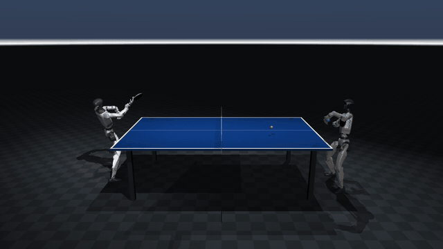
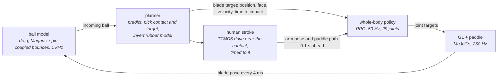
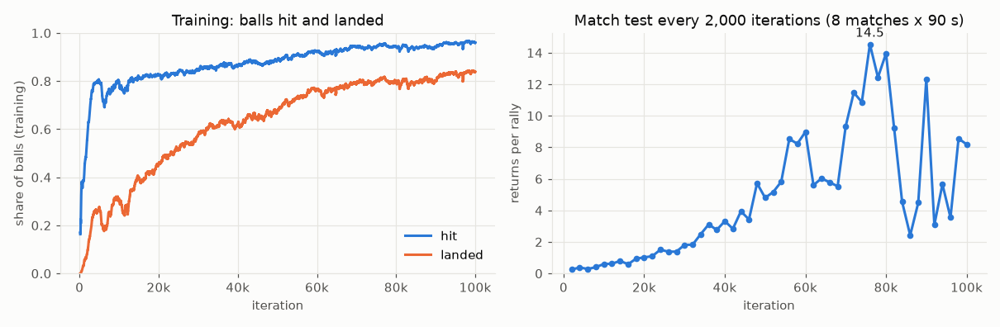

# g1-table-tennis

Two Unitree G1 humanoids learn to rally each other at table tennis in MuJoCo. One policy drives both robots and is trained from scratch by self-play with PPO. A model-based planner tells the robot where its paddle must be and how it must move (as in [HITTER](https://arxiv.org/abs/2508.21043)); the policy learns to deliver that with its whole body, guided by human forehand and backhand drives from motion capture. Simulation only.



## How it works



1. **Robots.** Two MuJoCo Menagerie G1s (29 joints each) with a 170 g paddle fixed to the right wrist, one behind each end of a regulation table. Robot B sees the world turned 180 degrees, so it stands exactly where robot A does and one network drives both (`src/g1tt/duel.py`).
2. **Ball** (`src/g1tt/ball.py`). Integrated outside MuJoCo at 1 kHz: a 2.7 g ball at 20 m/s tunnels through a 1 cm blade at robot time steps. Drag, Magnus lift, and an impulse bounce model where friction couples spin and slip; the paddle hit is a swept test against the blade disc. Details in [docs/physics.md](docs/physics.md).
3. **Planner** (`src/g1tt/planner.py`). Predicts the incoming ball, finds where it crosses a hitting plane after bouncing, chooses where the return should land, and inverts the rubber model for the blade position, face normal and velocity at impact. It re-plans once the ball has bounced. Returns are aimed at the partner: 65% to its forehand, 25% to its backhand (planned higher over the net and deeper) and 10% wide of its reach, so it has to step.
4. **Human strokes** (`src/g1tt/mocap.py`, `src/g1tt/reference.py`). 300 forehand and 151 backhand drives from the TTMD6 motion capture dataset, cleaned and retargeted onto the G1. For each planned hit the robot gets a stroke of the right side whose contact is near the target, slowed to the commanded blade speed, timed to the planned instant and shifted onto the planned contact.
5. **Policy** (`src/g1tt/duel_env.py`, `src/g1tt/ppo.py`). The actor sees proprioception, the planner's command, its offset from its spot, and the human stroke's arm pose and paddle path 0.1 s ahead; never the ball. The critic also sees the ball, its spin and every randomised physical constant.

## Training recipe

Self-play from scratch: both robots in a match run the current policy, and each one's returns are the other's incoming balls. All defaults in `src/g1tt/train.py` and `src/g1tt/env.py`.

| Choice | Setting | Why |
|---|---|---|
| Algorithm | PPO, asymmetric actor-critic, 512-256-128, adaptive learning rate on KL | The critic's privileged state gives better values than the actor's inputs could |
| Rewards | Hit and land on target; graded shot quality at contact; a return the partner can play; blade on the human paddle path, face and velocity at the planned instant; follow the human waist, arms and legs (and wrist on backhands); stay up, smooth, near the spot | Dense shaping towards the planned contact, credit for the outcome |
| Backhands | Shot and landing rewards x2; only a hit with the commanded face scores | A backhand needs the paddle turned over, which the forehand habit resists |
| Serve curriculum | Slow, nearly spinless serves first; harder each time 40% are hit | A first hit is hard to find at full speed and spin |
| Success Guided Sampling | Half the serves and returns are picked where recent success is near 50% ([SGS](https://arxiv.org/abs/2610.12465)) | Practice where learning happens |
| Randomisation | Drag, Magnus, table and rubber restitution and friction per match; the planner only knows nominal values | The plan is always a little wrong, as on a real robot |
| Matches | 10 s, a fall ends it for both robots | Short episodes keep data diverse |

## Install

```bash
tools/fetch_assets.sh                 # G1 model from MuJoCo Menagerie
uv venv -p 3.12 .venv
uv pip install --python .venv/bin/python -e ".[dev]"
.venv/bin/python -m pytest
```

## Human motion data

Download TTMD6 (Zhang et al., Sci. Rep. 14:3549, 2024; data on Baidu Pan from the paper's data availability statement) and unpack it so that `data/ttmd6/TTMD6/TTMD_cut_hum/` and `.../TTMD_cut_bat/` exist, then:

```bash
.venv/bin/python -m g1tt.mocap        # writes data/ttmd6_g1.npz (~30 s)
```

## Train

On a laptop CPU (9 worker processes, 432 matches):

```bash
.venv/bin/python -m g1tt.train --tag g1                 # 100,000 iterations, the recipe
.venv/bin/python -m g1tt.train --tag g1 --resume        # continue after a stop
```

`runs/<tag>/` holds `log.jsonl` (one row per logged iteration: return, hit and landing rate, rally length, SGS state, the mean of every reward term), `cfg.json`, `ckpt.pt` (latest) and a `ckpt_<iter>.pt` snapshot every 2,000 iterations. On an Apple M4 (10 cores) an iteration takes about 3 s, so the full run takes about 3.4 days.

### On a Kaggle GPU

Demo notebook: [Unitree G1 Humanoids Learn Table Tennis Rallies](https://www.kaggle.com/code/supatroongpraiwan/unitree-g1-humanoids-learn-table-tennis-rallies). It clones this repo, installs MuJoCo Warp and JAX, checks the GPU environment against the CPU one, trains, and plots the curves.

On the GPU the whole match (both robots, the ball, the rally rules, the rewards and the planner) is one compiled JAX step over 2,048 matches, with the physics in MuJoCo Warp (`src/g1tt/gpu/`). It computes the same observations and rewards as the CPU environment (`tests/test_gpu_duel.py`), and checkpoints move between the two.

To run the notebook yourself:

1. Build `data/ttmd6_g1.npz` as in [Human motion data](#human-motion-data).
2. Upload it to Kaggle as a private dataset (Datasets, New Dataset).
3. Open the notebook and click Copy & Edit. In the side panel, use Add Input to attach your dataset, set Accelerator to GPU T4 x2, and turn Internet on. Kaggle allows GPU and Internet only on phone-verified accounts.
4. Change the settings cell if you want (run name, `g1tt.gpu.train_gpu` arguments), then Save Version, Save & Run All.

Or start it from the command line, with the [kaggle CLI](https://github.com/Kaggle/kaggle-api) and a token in `~/.kaggle`:

```bash
git push   # the notebook clones the current commit from GitHub
python tools/kaggle/push.py --user <kaggle-user> --name g1
kaggle kernels output <kaggle-user>/unitree-g1-humanoids-learn-table-tennis-rallies -p runs/kaggle   # when it finishes
python tools/kaggle/push.py --user <kaggle-user> --name g1 --resume runs/kaggle/runs/g1               # next session
```

The first push uploads `data/ttmd6_g1.npz` to your private dataset `<kaggle-user>/g1tt-strokes`. Every push publishes the notebook, built from [tools/kaggle/train_notebook.py](tools/kaggle/train_notebook.py), and starts a run; add `--private` to keep it private. `--resume` uploads the run folder as the private dataset `<kaggle-user>/g1tt-runs`.

On Kaggle's GPU T4 x2 an iteration is 2,048 matches (98k decisions, 4.7 times a CPU iteration) and takes about 5.6 s: 17,500 decisions per second, 2.5 times the M4. Kaggle stops a session after 12 hours, so training saves and stops at 11 hours (about 7,000 iterations); the default 21,000 iterations, the same experience as 100,000 on the CPU, take about 33 GPU hours over three sessions.

## Results

One run of the recipe from scratch on an Apple M4: 100,000 iterations, 2.1 billion decisions, about 81 hours.



Hits come first (80% within 5,000 iterations); landing them and keeping rallies going takes the rest. The match test is noisy from one checkpoint to the next, so the policy kept is the one at 76,000 iterations, the best of the late checkpoints.

Matches with the training aims (65% of returns to the forehand, 25% to the backhand, 10% wide), deterministic policy, physics randomised, 16 matches of 120 s:

| Iteration | Returns per rally (mean) | Median / 90th / 99th percentile | Longest | Forehands landed | Backhands landed | Hits 0.2 m+ off the spot | Falls |
|---|---|---|---|---|---|---|---|
| 76,000 | **10.7** | 3 / 32 / 92 | 120 | 84% (189 of 226) | 96% (2,233 of 2,334) | 296 | 9 |
| 100,000 | 6.4 | 1 / 17 / 84 | 121 | 77% (265 of 342) | 96% (1,858 of 1,940) | 748 | 14 |

Rallies at 76,000 iterations end on a return that does not land (135), a miss (67), a fall (9) or the time limit (15).

Searching 36 single matches of 300 s each (5% of returns wide, 5% to the backhand) finds a longest rally of 272 returns at 76,000 iterations and **392** at 100,000: 245 seconds of play, 324 of its hits made with the pelvis 0.2 m or more off its spot, ending on a fault. The demo at the top is from it.

Most of the play is backhand to backhand: 91% of hits in the match test. The stroke follows from where the ball reaches the robot (a backhand when the contact is less than 0.15 m to the right of its spot), and although 65% of returns are aimed at the partner's forehand, most of them arrive on its backhand side. Backhands land 96% of the time, forehands 84%; better forehands, and returns that go where they are aimed, are the obvious next steps.

```bash
.venv/bin/python -m g1tt.duel runs/g1/ckpt_76000.pt --matches 16 --seconds 120 --seed 100
.venv/bin/python tools/search_rallies.py runs/g1/ckpt_100000.pt --seeds 0-35 --seconds 300 --min 30 --wide-frac 0.05 --bh-frac 0.05
.venv/bin/python -m g1tt.duel runs/g1/ckpt_100000.pt --matches 1 --seed 13 --seconds 247 --wide-frac 0.05 --bh-frac 0.05 --video renders/rally.mp4
```

## Evaluate and watch

```bash
.venv/bin/python -m g1tt.duel runs/g1/ckpt.pt --matches 16 --seconds 120          # match statistics
.venv/bin/python tools/search_rallies.py runs/g1/ckpt.pt --seeds 0-35 --min 30     # long rallies, many seeds
.venv/bin/python -m g1tt.duel runs/g1/ckpt.pt --find-rally 16 --seconds 300        # film the longest
```

Matches are seeded and the policy is deterministic, so `--seed S --matches 1` replays any rally the search finds; add `--video renders/rally.mp4` to film it.

## What is not here yet

- **A separate tracking stage.** [LATENT](https://arxiv.org/abs/2603.12686) first trains a general motion tracker on the human data and then distils; here the human strokes enter as a reward and an observation in a single policy, closer to HITTER.
- **Pushes, attacks and serves.** TTMD6 pushes meet the ball below table height once scaled to the G1, and attacks swing at about 11 m/s; only drives are used. A machine serves every rally.
- **A competitive opponent.** The robots cooperate: each aims balls the other can reach.
- **Rubber.** No sponge or tackiness model: each rubber is a restitution and a friction coefficient.

## Credits

Human strokes: TTMD6, Zhang, Ren, Lin, Xing and Ren, "Table tennis motion recognition based on the bat trajectory using varying-length-input convolution neural networks", Scientific Reports 14:3549 (2024), CC BY 4.0. The dataset is not redistributed here.

The G1 model is from [MuJoCo Menagerie](https://github.com/google-deepmind/mujoco_menagerie) (BSD-3-Clause, Unitree Robotics). The approach follows [HITTER](https://arxiv.org/abs/2508.21043) and [LATENT](https://arxiv.org/abs/2603.12686), and the sampling [Success Guided Sampling](https://arxiv.org/abs/2610.12465); no code from them is used.
